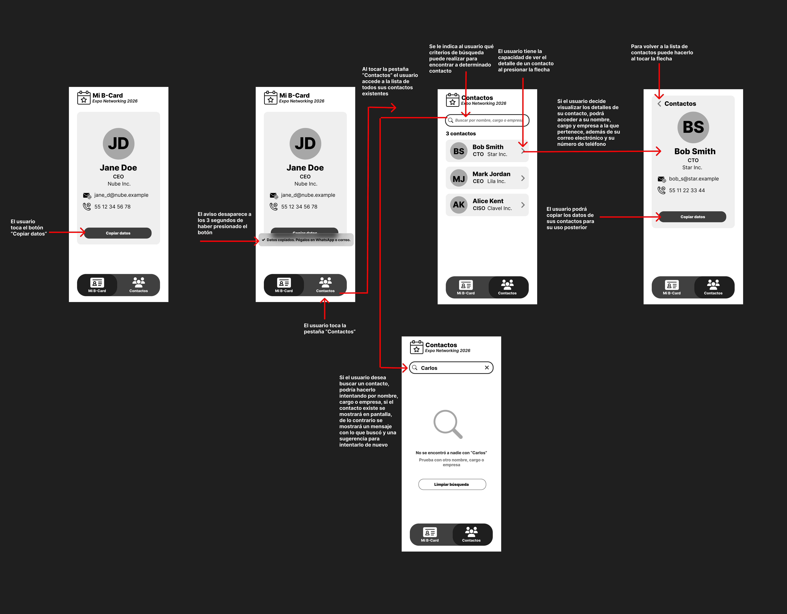
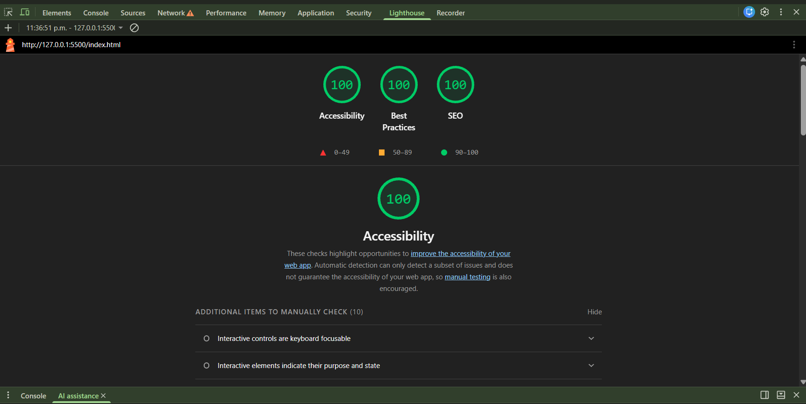

# BinkBe Networker · Prototipo (Ruta A: Web)

Prototipo web móvil con dos vistas conectadas: **Mi B-Card** y **Mis contactos**, para una persona que asiste por primera vez a un evento de networking.

- 🔗 **Demo:** [Ver prototipo en línea](https://taniavmc.github.io/prueba-tecnica/)
- 🎨 **Wireframe:** [Imagen](docs/wireframe.png) · [Ver en Figma](https://www.figma.com/design/DysLHvvZY6PCXVaVi7t2sU/Prueba-t%C3%A9cnica?node-id=0-1&t=Xqbfc5BlpVhe4Qtl-1)
- 🎬 **Video:** [Ver demostración](AGREGA-AQUÍ-EL-ENLACE)



---

## Nota breve

- **Problema priorizado:** en un evento, la persona necesita compartir su tarjeta rápido y recordar a quién conoció.
- **Decisión principal de UX:** la app abre en Mi B-Card con "Copiar datos" como acción principal y confirmación visible; en Contactos, búsqueda en vivo por nombre, cargo o empresa, con estado "sin resultados" y una salida clara.
- **Tecnología:** HTML, CSS y JavaScript sin frameworks ni backend; datos simulados.
- **IA:** [COMPLETA: por ejemplo, "Claude (Anthropic) para orientación de UX, retroalimentación del wireframe y generación de código base, que revisé, ajusté y probé"].

---

## Cómo ejecutarlo

**Opción 1:** abre la demo en GitHub Pages.

**Opción 2 (local):**
1. Descarga o clona este repositorio.
2. Abre la carpeta en Visual Studio Code.
3. Clic derecho en `index.html` → **Open with Live Server**.

> También funciona abriendo `index.html` directamente en el navegador, pero el botón "Copiar datos" puede mostrar el mensaje de error porque algunos navegadores solo permiten copiar en páginas `https` o `localhost`.

---

## Funciones

| Requisito | Cómo se cumple |
|---|---|
| Mi B-Card | Nombre, cargo y empresa ficticios + botón **Copiar datos** que copia al portapapeles y muestra un aviso de confirmación (3 s). |
| Mis contactos | 3 contactos ficticios, **búsqueda en vivo** (sin importar mayúsculas ni acentos) y **detalle** de cada contacto. |
| Navegación | Barra inferior con 2 pestañas; el detalle tiene botón "‹ Contactos" para regresar. |
| Estados alternativos | **Sin resultados** (con botón "Limpiar búsqueda"), **confirmación** al copiar y **error** si el navegador no permite copiar. |

### Cómo probar los estados
- **Confirmación:** toca "Copiar datos".
- **Sin resultados:** escribe en el buscador un nombre que no exista, por ejemplo "Carlos".

---

## Decisiones de diseño y accesibilidad

- **Móvil primero** (diseñado a 390 px), centrado en una columna de 480 px en pantallas grandes.
- **Zona del pulgar:** acciones principales y navegación en la parte inferior.
- **Áreas táctiles** de al menos 44–48 px.
- **HTML semántico:** `main`, `section`, `nav`, `header`, `button`, `label`.
- **Lectores de pantalla:** el aviso de confirmación y el número de resultados se anuncian con `aria-live`; la pestaña activa usa `aria-current`; los íconos decorativos se ocultan.
- **Teclado:** todo se puede usar con Tab y Enter, con foco visible. Al abrir y cerrar el detalle, el foco se mueve de forma lógica.
- **Contraste:** colores sólidos (en lugar de opacidades) para garantizar un contraste predecible.
- **Movimiento reducido:** se respetan las preferencias del sistema (`prefers-reduced-motion`).
- - **Lighthouse (móvil):** Accesibilidad 100 · Buenas prácticas 100 · SEO 100. 

---

## Estructura

```
├── index.html      Estructura de las vistas
├── styles.css      Estilos (variables de diseño del wireframe)
├── data.js         Datos ficticios
├── app.js          Navegación, copiar, búsqueda y detalle
├── assets/icons/   Íconos PNG
└── docs/           Wireframe
```

---

## Créditos

- Íconos de calendario, correo, teléfono y tarjeta: [Flaticon](https://www.flaticon.com).
- Íconos de lupa, flecha, cerrar y personas: [Iconify](https://iconify.design) (Bootstrap Icons, Material Icons, Hugeicons, Font Awesome).
- Fuente: [Inter](https://fonts.google.com/specimen/Inter) (Google Fonts).

Todos los nombres, datos y contactos son ficticios.
